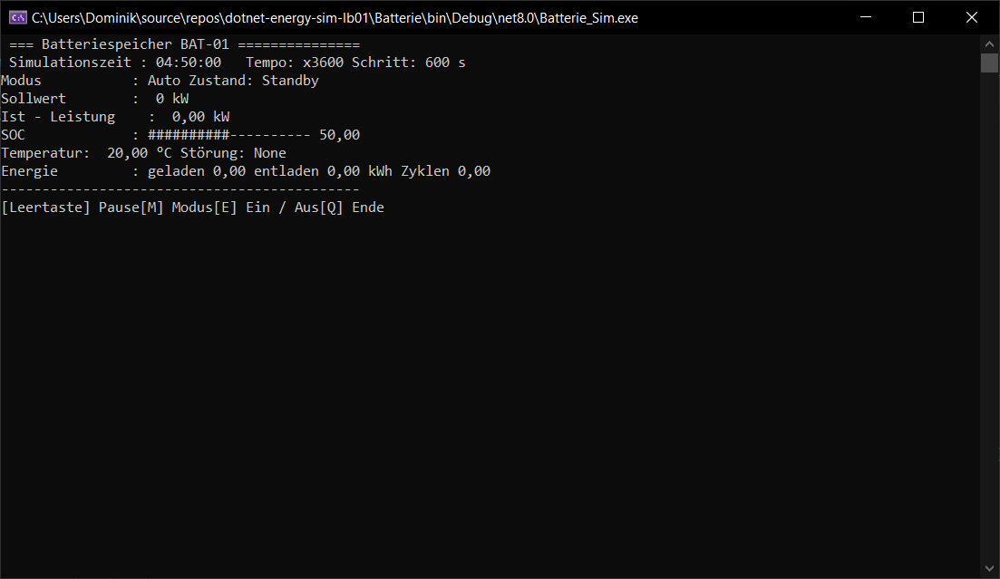

# Batteriespeicher-Simulator

Konsolenanwendung in C# (.NET), die einen **Batteriespeicher** als eigenständiges, simuliertes Gerät abbildet. Der Speicher wird mit Leistungsvorgaben geladen und entladen, der Ladezustand (SOC) wird über die Simulationszeit berechnet. Im Gesamtprojekt wird er später mit der PV-Anlage und der Ladestation zusammengeführt. Dieses Programm simuliert das Gerät einzeln.

## Voraussetzungen

- **.NET 10 SDK** (<https://dotnet.microsoft.com/download>). Prüfen mit `dotnet --version`.
- Windows-Konsole (Visual-Studio-Debugging-Konsole, Windows Terminal oder Eingabeaufforderung), mindestens 80 Zeichen breit und 15 Zeilen hoch.
- Die Konsole muss **interaktiv** sein (Tastatureingaben). Die Eingabe darf nicht umgeleitet werden.
- Teil der Solution `EnergyTwin.sln` im Repository-Hauptordner. Das Projekt verweist auf `src/Devices.Common`
  (bringt EasyModbusTCP.NETCore mit, wird beim ersten Build aus NuGet geladen). Der LB01-Code nutzt das noch nicht.

## Starten

Aus dem Repository-Hauptordner:

```
dotnet run --project src/Devices/BatterySimulator -- <Argumente>
```

oder im Projektordner `src/Devices/BatterySimulator`:

```
dotnet run -- <Argumente>
```

Beispiel (im Projektordner):

```
dotnet run -- --id BAT-01 --capacity 10 --start 06:00
```

Die weiteren Beispiele in dieser Datei gehen vom Projektordner aus.

In Visual Studio: `EnergyTwin.sln` öffnen, `BatterySimulator` als Startprojekt festlegen, dann *Projekt → Eigenschaften → Debuggen → Befehlszeilenargumente*, dort die Argumente eintragen (ohne `dotnet run --`).

> **Ab LB02** kommt die Zeit vom Simulations-Master (`--master`). Die Aufrufe unten (LB01) laufen nur noch mit `--standalone`; `--speed`, `--start` und
> `--duration` gelten nur dort, `--start` jetzt mit Datum (`"2026-01-15 06:00"`). Siehe Abschnitt „LB02“ am Ende.

Ohne Argumente (und ohne Master) wartet das Gerät auf den Simulations-Master; mit `--standalone` läuft es mit den Standardwerten auf einer lokalen Uhr.

### Kommandozeilenargumente

| Argument | Bedeutung | Standard |
|---|---|---|
| `--id` | Geräte-ID (auch im CSV-Dateinamen) | BAT-01 |
| `--capacity` | Kapazität in kWh | 20 |
| `--max-charge` | max. Ladeleistung in kW | 5 |
| `--max-discharge` | max. Entladeleistung in kW | 5 |
| `--soc-min` | SOC-Untergrenze in % | 10 |
| `--soc-max` | SOC-Obergrenze in % | 100 |
| `--soc-start` | Start-SOC in % | 50 |
| `--speed` | (standalone) Simulationssekunden pro Realsekunde | 600 |
| `--step` | Schrittweite in Simulationssekunden | 60 |
| `--duration` | (standalone) Simulationsdauer in Stunden; ohne Angabe endlos | endlos |
| `--start` | (standalone) Startzeit `yyyy-MM-dd HH:mm` | heute 00:00 |

Hinweise:

- Dezimalzahlen werden in den Argumenten mit **Punkt** geschrieben (`--capacity 7.5`).
- Ungültige Eingaben beenden das Programm mit einer Fehlermeldung. Geprüft werden: `--speed` und `--step` größer als 0, `--capacity` größer als 0, `--soc-min` kleiner als `--soc-max`.

### Beispielparameter

| Zweck | Aufruf |
|---|---|
| Standardlauf | `dotnet run` |
| Schneller Demolauf (24 h in ca. 24 s) | `dotnet run -- --speed 3600` |
| Kleine Batterie, ganzer Zyklus ab Morgen | `dotnet run -- --capacity 10 --start 06:00 --soc-start 20` |
| Leistungsbegrenzung sichtbar machen | `dotnet run -- --max-charge 2 --max-discharge 2` |
| Feinere Zeitauflösung | `dotnet run -- --step 10 --speed 600` |
| Dauerbetrieb (Tagesprofil wiederholt sich) | `dotnet run -- --duration 0` |
| Zweites Gerät parallel (zweites Terminal) | `dotnet run -- --id BAT-02 --capacity 10` |

## Bedienung

Während der Simulation zeigt ein festes Dashboard Simulationszeit, Tempo, Modus, Gerätezustand, Soll- und Ist-Leistung, SOC (Zahl und Balken), Temperatur, aktive Störung sowie Energie- und Zykluszähler.

### Tasten im laufenden Betrieb

| Taste | Funktion |
|---|---|
| Leertaste | Pause (nur standalone; mit Master pausiert der Master) |
| S | Einstellungen öffnen (löst das Pausenmenü ab) |
| M | Umschalten Auto / Manuell (beim Wechsel auf Manuell wird der Sollwert 0) |
| Pfeil hoch / runter | Sollwert um 0,5 kW erhöhen / senken (nur im Manuell-Modus) |
| 0 | Sollwert auf 0 kW (nur im Manuell-Modus dauerhaft, im Auto-Modus überschreibt das Profil ihn wieder) |
| E | Gerät ein- bzw. ausschalten |
| N | Not-Aus auslösen |
| H | Überhitzung auslösen |
| R | Störung zurücksetzen |
| Q | Beenden |

Zum Beenden immer **Q** drücken (oder die Simulationsdauer ablaufen lassen). Wird der Debugger hart gestoppt, kann das Ende der CSV-Datei fehlen.

### Pausenmenü (LB01) und Einstellungen (LB02)

In LB01 hielt die Leertaste die Simulation an und öffnete ein Menü. Ab LB02 steuert der Master die Pause; die Einstellungen öffnet `S`, die Zeit läuft dabei weiter,
Tempo und Schrittweite sind dort nicht mehr änderbar. Änderbar sind:

1. Sollwert (wechselt dabei in den Manuell-Modus)
2. Maximale Ladeleistung
3. Maximale Entladeleistung
4. SOC-Untergrenze
5. SOC-Obergrenze
6. Simulationsgeschwindigkeit
7. Schrittweite
8. Fortsetzen

Im Menü werden Dezimalzahlen mit der **Schreibweise des Betriebssystems** eingegeben, bei deutschen Windows-Einstellungen also mit **Komma** (`3,5`). Ungültige Werte werden abgelehnt und der alte Wert bleibt bestehen. Die Zeit, die man im Menü verbringt, wird nicht nachgeholt.

## Modellbeschreibung

### Grundprinzip

Vorzeichen: **positive Leistung = Laden, negative Leistung = Entladen.** Das Gerät bekommt einen **Sollwert**, entweder vom Tagesprofil (Auto), per Tasten oder über das Pausenmenü (Manuell). Es liefert die **Ist-Leistung**, also das, was es unter den aktuellen Bedingungen darf. Unzulässige Sollwerte werden nicht abgelehnt, sondern still begrenzt, so wie es ein Batteriemanagementsystem tut. Soll und Ist werden getrennt angezeigt und protokolliert.

### Begrenzung der Leistung

```
erlaubt_laden    = max_laden    × Taper(SOC) × Derating(T)
erlaubt_entladen = max_entladen × Derating(T)

Ist = Soll, begrenzt auf  −erlaubt_entladen … +erlaubt_laden
```

Zusätzlich gilt:

- Bei SOC an der Obergrenze ist Laden gesperrt, bei SOC an der Untergrenze ist Entladen gesperrt.
- Innerhalb eines Schritts wird nur so viel Energie umgesetzt, wie bis zur Grenze noch hineinpasst (bzw. entnommen werden kann). Der SOC überschreitet die Grenzen deshalb auch bei großen Schrittweiten nicht.
- Bei Aus, Not-Aus oder Überhitzungsabschaltung ist die Ist-Leistung 0.

### Ladezustand (SOC)

```
SOC(neu) = SOC + Ist-Leistung × Δt[h] / Kapazität[kWh] × 100
```

### Leistungsreduzierung bei hohem SOC (Taper)

Nur beim Laden: Bis 80 % SOC volle Leistung, danach sinkt die erlaubte Ladeleistung linear auf 10 % der Maximalleistung bei der SOC-Obergrenze. Die Ladekurve läuft dadurch flach aus.

### Temperatur und Derating

Die Temperatur ändert sich pro Simulationsminute um

```
ΔT = ( 0,06 × |Ist-Leistung|  −  0,02 × (T − 20 °C)  +  Störungswärme ) × Δt[min]
```

Bei dauerhaft 5 kW pendelt sich die Temperatur bei etwa 35 °C ein.

| Temperatur | Verhalten |
|---|---|
| unter 45 °C | volle Leistung |
| 45 bis 60 °C | Leistung sinkt linear von 100 % auf 0 % (Derating, gilt für Laden und Entladen) |
| ab 60 °C | Abschaltung, Zustand `Fault` |
| nach Reset bis 50 °C | Zustand `Cooldown`, gesperrt |
| 50 °C oder darunter | wieder freigegeben |

### Gerätezustände

`Off`, `Standby`, `Charging`, `Discharging`, `Fault`, `Cooldown`. Laden und Entladen ergeben sich aus der Ist-Leistung (Totzone ±0,01 kW).

### Störungen

| Störung | Auslösen | Wirkung | Zurücksetzen |
|---|---|---|---|
| Not-Aus | Taste N | Ist-Leistung sofort 0, Sollwert wird 0, Zustand `Fault` | Taste R, danach `Standby` |
| Überhitzung | Taste H | zusätzliche Wärmequelle (2 °C pro Minute), Derating ab 45 °C, Abschaltung bei 60 °C | Taste R schaltet die Wärmequelle ab, bis 50 °C `Cooldown`, danach frei |

Im Auto-Modus bleibt das Profil während einer Störung aktiv, die Ist-Leistung ist aber 0. Nach dem Reset läuft es an der aktuellen Simulationszeit weiter, in der CSV entsteht dadurch eine sichtbare Lücke. Eine Überhitzung allein durch Last erreicht wegen des Deratings praktisch nie 60 °C. Die manuelle Störung ist der vorgesehene Weg, sie auszulösen.

### Zähler

Geladene und entladene Energie in kWh sowie äquivalente Vollzyklen: `(geladen + entladen) / (2 × Kapazität)`.

### Auto-Modus: Tagesprofil

Das Profil liefert den Sollwert abhängig von der Tageszeit. Es hängt an der Simulationsuhr und wiederholt sich im Dauerbetrieb täglich.

| Zeit | Sollwert |
|---|---|
| 00:00 bis 07:00 | 0 kW |
| 07:00 bis 17:00 | Laden, Sinuskurve mit Maximum um 12:00 |
| 17:00 bis 18:00 | 0 kW |
| 18:00 bis 23:00 | Entladen, Grundlast mit Spitze um 19:30 |
| 23:00 bis 24:00 | 0 kW |

Auf den Sollwert wird ein Zufallsfaktor von ±10 % gelegt, der alle 5 Simulationsminuten neu gewürfelt wird. Das Profil beschreibt nur den Wunsch, die Begrenzungen des Geräts greifen weiterhin. Bei den Standardwerten ist die Batterie deshalb am Vormittag voll und am Abend vor Ende des Profils leer.

### Simulationsuhr

Die Hauptschleife läuft alle etwa 100 ms in Echtzeit. Aus der vergangenen Realzeit und der eingestellten Geschwindigkeit wird Simulationszeit gutgeschrieben, und für jede volle Schrittweite wird ein Rechenschritt ausgeführt. Geschwindigkeit und Schrittweite sind damit unabhängig voneinander einstellbar. Bei Speed 600 und Schritt 60 s entspricht eine Realsekunde zehn Rechenschritten (zehn Simulationsminuten). Während der Pause wird keine Zeit gutgeschrieben.

## CSV-Verlauf

Pro Gerät entsteht eine Datei `battery_<ID>_<Datum>.csv` in `docs/data/` im Repository, egal aus welchem Ordner (Kommandozeile oder Visual Studio) gestartet wird. Es wird **bei jedem Simulationsschritt** eine Zeile geschrieben, mit dem Zustand am Ende des Schritts. Trennzeichen ist das Semikolon, Dezimalzeichen der Punkt.

| Spalte | Bedeutung |
|---|---|
| `SimTime` | Simulationszeit (Tag.Stunde:Minute:Sekunde, z. B. `1.06:15:00`) |
| `DeviceId` | Geräte-ID |
| `Mode` | Gerätezustand (Off, Standby, Charging, Discharging, Fault, Cooldown) |
| `Control` | Auto oder Manual |
| `SetpointKW` / `ActualKW` | Soll- und Ist-Leistung |
| `SOC` | Ladezustand in % |
| `TempC` | Temperatur in °C |
| `Fault` | aktive Störung (None, EmergencyStop, Overheat) |
| `MaxChargeKW` / `MaxDischargeKW` | aktuelle Leistungsgrenzen |
| `SocMin` / `SocMax` | aktuelle SOC-Grenzen |

Die CSV darf während des Laufs nicht in Excel geöffnet sein. Zwei Instanzen mit **derselben ID** am selben Tag blockieren sich gegenseitig, daher pro Instanz eine eigene `--id` verwenden.

## Aufbau

| Klasse | Aufgabe |
|---|---|
| `Batterie` | Physik des Geräts: Begrenzung, SOC, Temperatur, Zustände, Störungen, Zähler |
| `BatterieConfig` | Einstellungen (ID, Kapazität, Leistungen, SOC-Grenzen) |
| `DailyProfile` | Tagesprofil mit Rauschen für den Auto-Modus |
| `Simulator` | Simulationsuhr, Hauptschleife, Tasten, Pausenmenü |
| `CsvLogger` | schreibt den Verlauf |
| `ConsoleDashboard` | feste Statusanzeige |
| `Program` (`main.cs`, Top-Level-Statements) | liest die Argumente und startet die Simulation |

`Batterie` kennt weder Konsole noch Uhr noch Profil und nimmt Leistungsvorgaben ausschließlich über `SetPower(kW)` entgegen. Dadurch kann später ein externer Controller (z. B. bei der Kopplung mit PV-Anlage und Ladestation) den Sollwert vorgeben.

## Bekannte Einschränkungen

- Wirkungsgrad, Selbstentladung, Spannung/Strom und Alterung (SOH) sind nicht modelliert.
- Die Kopplung mit PV-Anlage und Ladestation ist noch nicht umgesetzt. Das Gerät läuft eigenständig.
- Die Eingaben im Pausenmenü werden nur grob geprüft, Dezimalzahlen müssen in der Schreibweise des Betriebssystems eingegeben werden.
- Ein Ereignisprotokoll im Dashboard und eine Zusammenfassung am Programmende gibt es nicht.



## Projektstruktur

Pfade relativ zum Repository-Hauptordner `dotnet-energy-twin-alpha/`:

```
src/Devices/BatterySimulator/
├── BatterySimulator.csproj           # Projekt (Einstellungen aus src/Directory.Build.props)
├── main.cs                           # Einstieg: Argumente lesen, Objekte erzeugen, starten
├── Batterie.cs                       # Gerätephysik
├── BatterieConfig.cs                 # Einstellungen
├── DailyProfile.cs                   # Tagesprofil (Auto-Modus)
├── Simulator.cs                      # Hauptschleife (Zeit vom Master, feste Schritte), Tasten, Einstellungen
├── ArgsParser.cs, SimulatorOptions.cs # Kommandozeile
├── BatteryModbus.cs                  # Modbus: Register veröffentlichen, Schreibzugriffe anwenden
├── CsvLogger.cs                      # CSV-Verlauf (async)
├── ConsoleDashboard.cs               # Statusanzeige
└── Enum.cs                           # DeviceState, ControlMode, FaultType

docs/                                 # zentral im Repository
├── data/battery_<ID>_<Datum>.csv     # CSV-Ausgabe (Beispiel: battery_BAT-01_2026-10-07.csv)
├── screenshots/BatterySimulator/bild.png
└── development-journal/dominik-Zach.md   # Entwicklungsjournal
```

---

## LB02 – Umbau zum Modbus-Feldgerät

**Zweck:** Batteriespeicher als Feldgerät im Gesamtsystem: virtuelle Zeit vom Simulations-Master, Zustand und Sollwert über Modbus TCP.
**Verantwortlich:** Dominik Zach (LB01-Gerät); Umbau auf Master-Zeit und Modbus am 2026-10-25 von Susanne Lastowicka (mit Dominik abzustimmen)
**Basis aus LB01:** Domi Batterie, BatterieConfig, DailyProfile

### Stand (2026-10-25)

| Schritt | Stand |
|---|---|
| Zeit vom Simulations-Master (`DeviceTimeSource`, `StepScheduler`, feste Schritte `--step`) | ✅ |
| Standalone mit lokaler Uhr (`--standalone`; Leertaste und `<`/`>` wirken nur dort) | ✅ |
| async Schleife, CSV, Tastatur und Einstellungsmenü (kein `Thread.Sleep`, kein `ReadLine`) | ✅ |
| Modbus-Server mit Registerplan, Server bleibt in der Pause erreichbar | ✅ |

### Konfiguration

| Option | Bedeutung | Standard |
|---|---|---|
| `--id`, `--capacity`, `--max-charge`, `--max-discharge`, `--soc-min`, `--soc-max`, `--soc-start` | Gerätedaten wie in LB01 (Tabelle oben) | |
| `--step <s>` | feste Schrittweite in Simulationssekunden | 60 |
| `--seed <zahl>` | Zufalls-Seed für das Tagesprofil | zufällig |
| `--master <host:port>` | Simulations-Master | `127.0.0.1:5100` |
| `--standalone` | ohne Master, lokale Uhr | aus |
| `--start <zeit>` | nur standalone, `yyyy-MM-dd HH:mm` (früher nur Uhrzeit) | heute 00:00 |
| `--speed <x>` | nur standalone, Tempo 1–100 000 | 600 |
| `--duration <h>` | nur standalone, Dauer; ohne Angabe endlos (früher 0 = endlos, Standard 24) | endlos |
| `--modbus-port <port>` | Modbus-TCP-Port, pro Gerät eigener | 1502 |
| `--modbus-bind <ip>` | Adresse des Servers | 127.0.0.1 |
| `--unit-id <n>` | Modbus-Unit-ID | 1 |
| `--no-modbus` | Server nicht starten | aus |
| `--register-plan` | Registerplan als Markdown ausgeben | |

Zusätzlich geprüft: `--max-charge`/`--max-discharge` > 0, `0 ≤ --soc-min < --soc-max ≤ 100`, `--soc-start` dazwischen. Dezimalzahlen mit Punkt **oder** Komma.

### Bedienung / Start

```
dotnet run --project src/SimulationMaster -- --speed 600          # 1. Master
dotnet run --project src/Devices/BatterySimulator -- --id BAT-01 --modbus-port 1503   # 2. Batterie
dotnet run --project src/Devices/BatterySimulator -- --standalone --speed 3600 --start "2026-01-15 06:00" --duration 24   # ohne Master
```

Tasten: Leertaste Pause (nur standalone, sonst Master), `<` / `>` Tempo ÷2 / ×2 (nur standalone), `M`, `↑`/`↓`, `0`, `E`, `N`, `H`, `R`, `Q` wie in LB01.
**`S` öffnet die Einstellungen** unter der Anzeige (löst das Pausenmenü ab): 1 Sollwert, 2 max. Ladeleistung, 3 max. Entladeleistung, 4 SOC-Min, 5 SOC-Max.
Die Zeit läuft währenddessen weiter, die Modbus-Register auch. Tempo und Schrittweite lassen sich nicht mehr im Programm ändern (Tempo: Master, Schritt: `--step`).
Die Anzeige hat neue Zeilen „Zeitquelle“, „Modbus“ und „Meldung“. Bei umgeleiteter Ausgabe erscheint alle 5 s eine Statuszeile.

### Modbus-Registerplan

Holding Registers (Funktionscode 03 lesen, 06/16 schreiben). Standard: Host `127.0.0.1`, Port `1502`, Unit-ID `1` – alle drei sind konfigurierbar.
Adressen sind Protokolladressen (0-basiert, Referenzadresse = 40001 + Adresse). Pro Register Big-Endian;
mehrteilige Werte (`UInt32`, `Float32`) belegen zwei Register, das höherwertige Wort steht zuerst (Float32 = IEEE 754, Byte-Folge ABCD).
Mehrteilige Werte müssen mit **einem** Schreibzugriff (FC16) auf beide Register geschrieben werden.

| Adresse | Ref. | Name | Typ | Regs | Einheit | Zugriff | Schreibbereich | Bedeutung / Fehlerverhalten |
|---|---|---|---|---|---|---|---|---|
| 0 | 40001 | Gerätetyp | UInt16 | 1 |  | lesen | – | 1 PV, 2 Batterie, 3 Charger, 4 Wind |
| 1 | 40002 | Geräte-Nummer | UInt16 | 1 |  | lesen | – | Zahl am Ende der Geräte-ID (DC-02 → 2), 0 wenn keine |
| 2 | 40003 | Betriebszustand | UInt16 | 1 |  | lesen | – | 0 Aus, 1 Bereit/Leerlauf, 2 Betrieb, 3 Störung |
| 3 | 40004 | Fehlercode | UInt16 | 1 |  | lesen | – | 0 = kein Fehler, sonst gerätespezifisch (siehe Registerplan des Geräts) |
| 4–5 | 40005 | Wirkleistung | Float32 | 2 | kW | lesen | – | Aktuelle Wirkleistung; positiv = Aufnahme, negativ = Abgabe |
| 6–7 | 40007 | Kumulierte Energie | Float32 | 2 | kWh | lesen | – | Energiezähler seit Programmstart (Bedeutung je Gerät im Registerplan) |
| 8–9 | 40009 | Modellzeit | UInt32 | 2 | s | lesen | – | Virtuelle Zeit des dargestellten Zustands, Sekunden seit 1970-01-01 00:00 (ohne Zeitzone); 0 = noch keine Zeit |
| 10 | 40011 | Lauf | UInt16 | 1 |  | lesen | – | Lauf-Nummer; ändert sich bei jedem Neustart im Master (Modellzeit springt dann) |
| 11 | 40012 | Sequenznummer | UInt16 | 1 |  | lesen | – | Zählt bei jeder neuen Modellzeit hoch (Überlauf bei 65535); gleiche Nummer = gleicher Zustand |
| 12 | 40013 | Zeitstatus | UInt16 | 1 |  | lesen | – | 0 keine Zeit, 1 synchron mit Master, 2 Standalone, 3 Master verloren (Zeit steht) |
| 13 | 40014 | Simulation läuft | UInt16 | 1 |  | lesen | – | 1 = virtuelle Zeit läuft, 0 = pausiert oder keine Zeit; bei Pause zeigen die Register den letzten Zustand |
| 14–15 | 40015 | Tempo | Float32 | 2 | x | lesen | – | Simulationsgeschwindigkeit gegenüber Echtzeit |
| 16 | 40017 | Ein/Aus | UInt16 | 1 |  | lesen/schreiben | 0 … 1 | Lesen: 1 = Gerät ein. Schreiben: 0 aus, 1 ein |
| 17 | 40018 | Fehler zurücksetzen | UInt16 | 1 |  | lesen/schreiben | 1 … 1 | Schreiben von 1 setzt Störungen zurück, sofern das Gerät es zulässt; liest immer 0 |
| 18 | 40019 | Letzter Schreibfehler | UInt16 | 1 |  | lesen | – | 0 = letzter Schreibzugriff angenommen, 1 nicht beschreibbar, 2 ungültiger Wert, 3 Wert unvollständig geschrieben |
| 19 | 40020 | Adresse des letzten Schreibzugriffs | UInt16 | 1 |  | lesen | – | Erste Adresse des letzten Schreibzugriffs (bei Fehler: die fehlerhafte Adresse) |
| 20–21 | 40021 | Leistungssollwert | Float32 | 2 | kW | lesen/schreiben | -1000 … 1000 | Sollwert der Leistung: positiv laden, negativ entladen. Gültig von −max. Entladeleistung bis +max. Ladeleistung (Register 37 und 35, Standard ±5 kW), sonst abgelehnt (Letzter Schreibfehler = 2). Ein Schreibzugriff schaltet in den Betriebsmodus Manuell |
| 22 | 40023 | Betriebsmodus | UInt16 | 1 |  | lesen/schreiben | 0 … 1 | 0 Auto (Tagesprofil bestimmt den Sollwert), 1 Manuell (Sollwert aus Register 20) |
| 23–24 | 40024 | Ladezustand (SOC) | Float32 | 2 | % | lesen | – | Ladezustand, zwischen SOC-Min und SOC-Max begrenzt |
| 25–26 | 40026 | Temperatur | Float32 | 2 | °C | lesen | – | Derating ab 45 °C, Abschaltung bei 60 °C (Fehlercode 2), Freigabe ≤ 50 °C |
| 27–28 | 40028 | Geladene Energie | Float32 | 2 | kWh | lesen | – | Seit Programmstart (entspricht der Energie im Kopf) |
| 29–30 | 40030 | Entladene Energie | Float32 | 2 | kWh | lesen | – | Seit Programmstart |
| 31–32 | 40032 | Vollzyklen | Float32 | 2 |  | lesen | – | Äquivalente Vollzyklen |
| 33–34 | 40034 | Kapazität | Float32 | 2 | kWh | lesen | – | Konfigurierte Kapazität |
| 35–36 | 40036 | Max. Ladeleistung | Float32 | 2 | kW | lesen | – | Konfiguriert (--max-charge) |
| 37–38 | 40038 | Max. Entladeleistung | Float32 | 2 | kW | lesen | – | Konfiguriert (--max-discharge) |
| 39–40 | 40040 | SOC-Minimum | Float32 | 2 | % | lesen | – | Konfiguriert (--soc-min) |
| 41–42 | 40042 | SOC-Maximum | Float32 | 2 | % | lesen | – | Konfiguriert (--soc-max) |
| 43 | 40044 | Gerätezustand | UInt16 | 1 |  | lesen | – | 0 aus, 1 Bereitschaft, 2 lädt, 3 entlädt, 4 Störung, 5 Abkühlung (Fehlercode im Kopf: 0 keiner, 1 Not-Aus, 2 Überhitzung, 3 Abkühlung nach Überhitzung) |

Besonderheiten des Batteriespeichers:
- **Leistung:** positiv = Laden (Aufnahme), negativ = Entladen (Abgabe). **Energie** im Kopf = geladene Energie, die entladene steht in Register 29–30.
- **Betriebszustand:** Aus, Bereitschaft, Betrieb (lädt/entlädt), Störung (Fault und Abkühlung).
- **Fehlercode:** 0 keiner, 1 Not-Aus, 2 Überhitzung, 3 Abkühlung nach Überhitzung (keine aktive Störung, Gerät sperrt bis ≤ 50 °C).
- **Sollwert (20–21):** gültig von −max. Entladeleistung bis +max. Ladeleistung (konfiguriert, Registerplan nennt nur die absolute Grenze ±1000 kW);
  alles außerhalb wird abgelehnt (Register 18 = 2), kein stilles Begrenzen. Ein Schreibzugriff schaltet in den Modus **Manuell**
  (im Auto-Modus würde das Tagesprofil den Wert sofort wieder überschreiben). Zurück in Auto: Register 22 = 0.
- **Ein/Aus (16):** wie Taste `E`; Aus setzt den Sollwert auf 0. **Fehler zurücksetzen (17):** wie Taste `R`.
- Fehlerverhalten bei Schreibzugriffen: siehe `src/Devices/DualPortCharger/README.md`, Abschnitt „Fehlerverhalten bei Schreibzugriffen“.

### CSV
`docs/data/battery_<ID>_<Datum>_<Uhrzeit>.csv`, neue Spalte `Lauf` am Ende, `SimTime` jetzt mit Datum (`yyyy-MM-dd HH:mm:ss`). Beim Start und bei jedem
Neustart im Master wird zusätzlich eine Zeile geschrieben.

### Schnittstellen
- **Benötigt:** Simulations-Master (TCP, `127.0.0.1:5100`).
- **Angeboten:** Modbus-TCP-Server (siehe Registerplan), CSV. Prüfen mit `src/ModbusDiagnosticClient`.

### Tests
- `tests/FieldDevices.Tests`: Modbus-Anbindung (Kopf, Vorzeichen, Sollwert innerhalb/außerhalb der konfigurierten Leistung, Modus, Störung, Reset, Ein/Aus),
  Optionen und Prüfungen, `Update(TimeSpan)`, wiederholbares Tagesprofil mit Seed.
- Probelauf 2026-10-25 mit Master (x600): synchron, Sollwert −2,5 kW per Diagnose-Client angenommen, 9 kW abgelehnt, Zurück auf Auto.

### Bekannte Probleme
- Ein Neustart im Master behält den Zustand (SOC, Temperatur, Zähler).
- Die interaktive Anzeige, die Tasten und das Einstellungsmenü sind nur mit umgeleiteter Ausgabe geprüft, noch nicht in einem echten Terminalfenster.
- Die Beispiel-CSV aus LB01 hat noch das alte Format (`SimTime` als Zeitdauer, ohne `Lauf`).
