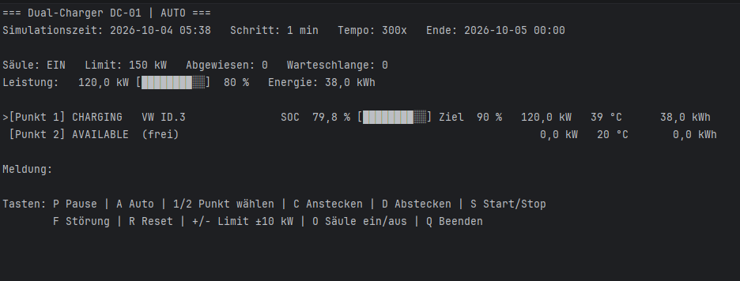
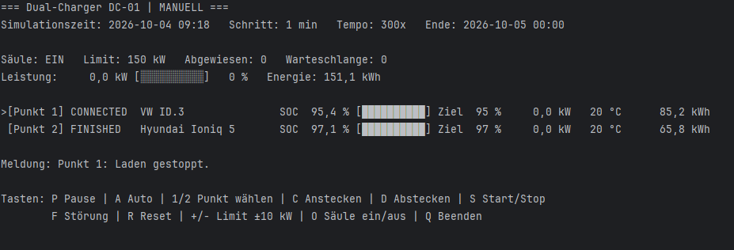
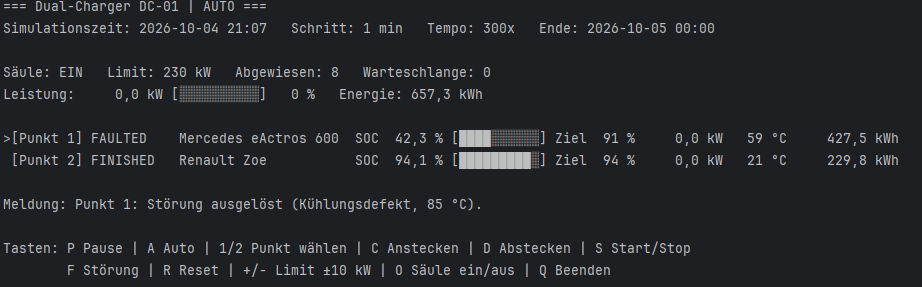
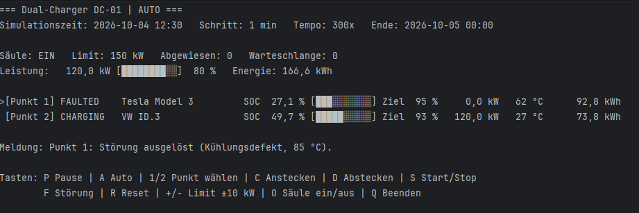

# dotnet-energy-sim-lb01 – Dual-Port-Charger

Konsolensimulator einer **öffentlichen DC-Schnellladesäule mit zwei Ladepunkten** und gemeinsamem Leistungsbudget (LB01, .NET Programmierung 2026).

Fahrzeuge kommen an, stecken an, laden nach einer SOC-abhängigen Ladekurve und fahren wieder ab. Die Säule teilt ihre Leistung zwischen den beiden Punkten auf. Die Ladepunkte erwärmen sich und können überhitzen. Jeder Schritt wird in eine CSV-Datei geschrieben.

**Seit LB02 (2026-10-25)** kommt die virtuelle Zeit vom **Simulations-Master** (`src/SimulationMaster`). Pause, Tempo und Neustart
steuert der Master für alle Geräte gemeinsam. Ohne Master läuft der Charger mit `--standalone` auf einer lokalen Uhr (wie in LB01).

---

## Voraussetzungen

- **.NET 10 SDK** (`dotnet --list-sdks` muss eine 10.x-Version zeigen)
- Windows, Linux oder macOS mit einer Konsole, die UTF-8 darstellt (für die Balken `█░`)
- Empfohlen: Konsolenfenster mit mindestens **140 Zeichen** Breite, sonst werden die Zeilen abgeschnitten
- Optional: Rider oder Visual Studio: `EnergyTwin.sln` öffnen, `DualPortCharger` als Startprojekt (Startprofil in `src/Devices/DualPortCharger/Properties/launchSettings.json`)
- Teil der Solution `EnergyTwin.sln` im Repository-Hauptordner. Das Projekt verweist auf `src/Devices.Common`
  (Zeitquelle, Schrittsteuerung, async Konsoleneingabe; bringt auch EasyModbusTCP.NETCore mit, das noch nicht genutzt wird).

## Start

Aus dem Repository-Hauptordner, **zuerst den Master**, dann den Charger (eigenes Konsolenfenster):

```bash
dotnet run --project src/SimulationMaster -- --speed 600      # Fenster 1: Master (startet pausiert, Leertaste = Start)
dotnet run --project src/Devices/DualPortCharger              # Fenster 2: Charger, verbindet sich mit 127.0.0.1:5100
```

Startet der Charger vor dem Master, zeigt er „WARTE AUF MASTER“ und versucht es alle 2 s erneut.
Ohne Master (z. B. zum Testen):

```bash
dotnet run --project src/Devices/DualPortCharger -- --standalone --speed 300 --duration 24
```

Ohne Argumente gelten die Standardwerte (siehe unten). Die Hilfe zeigt `--help`:

```bash
dotnet run --project src/Devices/DualPortCharger -- --help
```

### Kommandozeilenargumente

| Argument | Bedeutung | Standard | Erlaubt |
|---|---|---|---|
| `--id <text>` | Geräte-ID (erscheint in Anzeige und CSV-Dateiname) | `DC-01` | nicht leer |
| `--power <kW>` | Gesamtleistung der Säule | `150` | 50–350 |
| `--step <min>` | Schrittweite = Detailgrad (Rechenintervall, eine CSV-Zeile pro Schritt) | `5` | > 0 |
| `--seed <zahl>` | Zufalls-Seed für wiederholbare Läufe | zufällig | ganze Zahl |
| `--output <ordner>` | Zielordner der CSV (wird angelegt) | `docs/data` im Repo | gültiger Pfad |
| `--master <host:port>` | Simulations-Master | `127.0.0.1:5100` | Port 1–65535 |
| `--standalone` | ohne Master, lokale Uhr | aus | |
| `--start <zeit>` | nur standalone: Startzeit `yyyy-MM-dd HH:mm` | heute 00:00 | |
| `--speed <faktor>` | nur standalone: Tempo gegenüber Echtzeit | `120` | 1–100 000 |
| `--duration <h>` | nur standalone: Simulationsdauer in Stunden | endlos | > 0 (Warnung bei < 24) |
| `--modbus-port <port>` | Port des Modbus-TCP-Servers (jede Säule braucht einen eigenen) | `1502` | 1024–65535 |
| `--modbus-bind <ip>` | Adresse, auf der der Server lauscht | `127.0.0.1` | IP-Adresse (`0.0.0.0` = alle) |
| `--unit-id <n>` | Modbus-Unit-ID | `1` | 1–247 |
| `--no-modbus` | Modbus-Server nicht starten | aus | |
| `--register-plan` | Registerplan als Markdown ausgeben und beenden | | |
| `--weather <url\|off>` | Wettersimulator; mit Master Standard `http://127.0.0.1:8080`, standalone aus | mit Master `http://127.0.0.1:8080` | |
| `--location <ort>` | Standort für die Wetterabfrage | `salzburg` | |

Ungültige Werte oder unbekannte Argumente führen zu einer Fehlermeldung mit Hilfetext (Exit-Code 1).
`--start`, `--speed` und `--duration` ohne `--standalone` sind ein Fehler: Mit Master bestimmt der Master Zeit und Tempo.

**Echtzeit pro Schritt = Schrittweite / Tempo** (Tempo vom Master bzw. `--speed`). Beispiele:

| Schrittweite | Tempo | Echtzeit pro Schritt | 24 h dauern |
|---|---|---|---|
| 5 min | 120x | 2,5 s | 12 min |
| 1 min | 300x | 0,2 s | 4,8 min |
| 15 min | 600x | 1,5 s | 2,4 min |

### Beispielparameter

```bash
# Mit Master (Standard): 150 kW, 5-min-Schritte
dotnet run --project src/Devices/DualPortCharger

# Feiner Verlauf, reproduzierbar, Master auf einem anderen Rechner
dotnet run --project src/Devices/DualPortCharger -- --id DC-01 --power 150 --step 1 --seed 42 --master 192.168.1.20:5100

# Zweite Säule am selben Master (andere ID, anderer Modbus-Port)
dotnet run --project src/Devices/DualPortCharger -- --id DC-02 --power 100 --step 15

# Standalone wie in LB01: 24 h in 4,8 min, reproduzierbar
dotnet run --project src/Devices/DualPortCharger -- --standalone --step 1 --speed 300 --duration 24 --seed 42
```

Mehrere Instanzen mit verschiedenen `--id` können gleichzeitig laufen. Jede schreibt ihre eigene CSV und erscheint
einzeln in der Liste des Masters.

## Bedienung

Die Tasten wirken sofort, auch während die Simulation läuft:

| Taste | Befehl |
|---|---|
| `P` | nur standalone: Pause an/aus (Simulationszeit steht, keine CSV-Zeilen). Mit Master: Pause im Master |
| `A` | Auto-Modus an/aus |
| `N` | Manueller Modus: zufälliges Fahrzeug kommt, steckt am freien Punkt an und lädt sofort; abstecken mit `D` |
| `1` / `2` | Ladepunkt wählen (markiert mit `>`) |
| `C` | Fahrzeug an den gewählten Punkt anstecken: Modell, Start-SOC [20 %] und Ziel-SOC [100 %] eingeben, danach mit `S` starten |
| `D` | Fahrzeug abstecken (nicht bei Störung, das Kabel ist verriegelt) |
| `S` | Laden starten / stoppen |
| `F` | Störung auslösen (Kühlungsdefekt) |
| `R` | Störung zurücksetzen (erst unter 60 °C) |
| `+` / `-` | Gesamtleistung ±10 kW (50–350 kW) |
| `<` / `>` | nur standalone: Tempo halbieren / verdoppeln (1–100 000x). Mit Master: Tempo im Master |
| `O` | Säule ein/aus |
| `Q` | Beenden |

Die Zeile **Meldung** zeigt das Ergebnis jedes Befehls, auch warum ein Befehl gerade nicht möglich ist (z. B. „Reset erst unter 60 °C möglich (aktuell 72 °C)“).

Standalone mit `--duration`: Nach Ablauf bleibt die letzte Anzeige stehen, bis man `Q` drückt. Danach wird der Pfad der
CSV-Datei ausgegeben. `Q` oder Strg+C beenden jederzeit geordnet (Abmeldung beim Master, CSV wird geschlossen).

Die Eingaben beim Anstecken (`C`) werden ohne blockierendes Warten gelesen, `Esc` bricht ab. Während der Eingabe
rechnet das Modell nicht weiter; die fälligen Schritte werden danach nachgeholt (die Zeit kommt ja vom Master).

Die Zeile **Zeitquelle** zeigt den Zustand der Verbindung:

| Anzeige | Bedeutung |
|---|---|
| `WARTE AUF MASTER host:port – <Fehler>` | noch keine Zeit; Wiederverbindung alle 2 s |
| `Master host:port · synchron · LÄUFT · x600 · Lauf 1 · Abweichung ≤ 204 ms (RTT 0,7 ms)` | Normalbetrieb; Abweichung = größtmöglicher Fehler zum Master (RTT/2 · Tempo) |
| `MASTER host:port NICHT ERREICHBAR – Zeit steht, Wiederverbindung läuft` | 3 s nichts vom Master; das Modell hält an |
| `STANDALONE (lokale Uhr, ohne Master) · LÄUFT · x120` | `--standalone` |

Ein **Neustart im Master** (neue Zeit, neuer Lauf) wird übernommen: Die Modellzeit springt auf die neue Zeit,
der Zustand der Säule (Fahrzeuge, Temperaturen, Zähler) bleibt erhalten. Die Meldung zeigt „Neustart durch den Master“.

### Konsolenausgabe

```
=== Dual-Charger DC-01 | AUTO ===
Simulationszeit: So. 2026-10-04 17:30   Lauf: 1   Schritt: 5 min
Zeitquelle:      Master 127.0.0.1:5100 · synchron · LÄUFT · x120 · Lauf 1 · Abweichung ≤ 41 ms (RTT 0,7 ms)

Säule: EIN   Limit: 150 kW   Abgewiesen: 3   Warteschlange: 0
Leistung:   142,0 kW [█████████░]  95 %   Energie: 1 284,3 kWh

>[Punkt 1] CHARGING   VW ID.3               SOC  62,0 % [██████░░░░] Ziel  90 %   120,0 kW   41 °C     612,4 kWh
 [Punkt 2] CHARGING   Renault Zoe           SOC  84,0 % [████████░░] Ziel 100 %    22,0 kW   27 °C     671,9 kWh

Meldung: ...
```

Screenshots aus einem echten Lauf (LB01, noch ohne Zeile „Zeitquelle“):

| Auto-Modus | Manueller Modus |
|---|---|
|  |  |

| Limit-Erhöhung | Überhitzung |
|---|---|
|  |  |

---

## Modellbeschreibung

Ausführliche Herleitung und Begründungen: [`docs/devices/DualPortCharger/design-notes.md`](../../../docs/devices/DualPortCharger/design-notes.md).

### Klassen

```
DualCharger
 ├─ ChargingPoint [1]  ── 0..1 Vehicle
 └─ ChargingPoint [2]  ── 0..1 Vehicle
```

| Ordner | Klasse | Aufgabe |
|---|---|---|
| `Models` | `Vehicle` | Batterie (Kapazität, SOC, Ziel-SOC), Ladekurve |
| | `VehicleCatalog` | Fahrzeugmodelle, zufällige Fahrzeuge |
| | `ChargingPoint` / `ChargingPointState` | Zustandsautomat, Energie, Temperatur je Ladepunkt |
| | `DualCharger` | Leistungsbudget, Aufteilung, Warteschlange, Ein/Aus |
| `Simulation` | `SimulationEngine` | async Hauptschleife: Zeit von `DeviceTimeSource`, feste Schritte über `StepScheduler`, Neustart, CSV |
| | `AutoModeController` | Zufällige Ankünfte und Abfahrten |
| | `SimulationConfig` | Startparameter |
| `IO` | `ConsoleRenderer`, `InputHandler`, `CsvLogger`, `ArgsParser` | Anzeige, Tastatur, CSV, Kommandozeile (alle async) |
| `Devices.Common` | `DeviceTimeSource`, `StepScheduler`, `TimeSyncOptions`, `AsyncConsole` | gemeinsame Zeitanbindung aller Geräte |

`Program.cs` baut nur die Konfiguration und startet die Engine.

### Fahrzeuge

| Modell | Kapazität | Max. DC-Ladeleistung |
|---|---|---|
| Renault Zoe | 52 kWh | 50 kW |
| Fiat 500e | 42 kWh | 85 kW |
| VW ID.3 | 58 kWh | 120 kW |
| Tesla Model 3 | 60 kWh | 170 kW |
| Hyundai Ioniq 5 | 77 kWh | 220 kW |
| Mercedes eActros 600 (LKW) | 621 kWh | 400 kW |
| Kia EV6 (defekt) | 77 kWh | 240 kW |

Gerundete Realwerte. Fahrzeuge über 150 kW zeigen, dass die Säule begrenzt. Der LKW kann mehr aufnehmen, als die ganze Säule liefert. Der **Kia EV6 (defekt)** hat eine beschädigte Ladebuchse und überhitzt bei hoher Leistung (siehe Temperatur).

### Ladekurve (Leistung nicht konstant)

```
SOC ≤ 80 %:  P = P_max
SOC > 80 %:  P = P_max · e^(−k · (SOC − 80)),   k = ln(10) / 20
```

Bei 100 % SOC sind es noch 10 % der Maximalleistung. Ist der Ziel-SOC erreicht, wechselt der Punkt auf `FINISHED`.

### Aufteilung des Leistungsbudgets

Lädt nur ein Punkt, bekommt er das ganze Budget. Laden beide, bekommt jeder zunächst bis zur Hälfte, und was einer nicht braucht, geht an den anderen:

```
150 kW, Bedarf 15 + 150 kW  →  15 + 135 kW   (nicht starr 75 + 75)
```

### Energie und SOC

```
E_netz = P · Δt              (gezählte Energie)
E_akku = E_netz · η,  η = 0,95
ΔSOC   = E_akku / Kapazität · 100 %
```

Beim Erreichen des Ziel-SOC wird die Energie im letzten Schritt passend gekürzt. Die Leistung gilt jeweils für einen ganzen Schritt. Große Schrittweiten sind über 80 % SOC deshalb ungenauer, und darum ist die Schrittweite einstellbar.

### Zustände eines Ladepunkts

```
Available ──C──► Connected ──S──► Charging ──SOC ≥ Ziel──► Finished ──D──► Available
                     ▲                │
                     └──────S─────────┘
Faulted: aus jedem Zustand (F oder automatisch ab 80 °C)
```

`FINISHED` heißt: Das Fahrzeug ist voll, steckt aber noch und blockiert den Punkt. Bei `FAULTED` liefert der Punkt 0 kW, das Fahrzeug bleibt verbunden und der SOC bleibt stehen.

### Temperatur und Störung (Kabel/Stecker)

| Parameter | Wert |
|---|---|
| Umgebung | 20 °C (Standard; mit Wetterbezug vom Wettersimulator) |
| Beharrungstemperatur bei 150 kW | 55 °C |
| Zeitkonstante τ (normal / Kühlungsdefekt) | 10 min / 30 min |
| Derating | ab 60 °C linear bis 0 % bei 80 °C |
| Störung | ab 80 °C automatisch, mit `F` sofort auf 85 °C |
| Reset | manuell (`R`) unter 60 °C, automatisch unter 50 °C |

```
T_ziel = T_außen + 35 °C · (P / 150 kW)²       (Verluste ∝ I²; T_außen standardmäßig 20 °C)
T_neu  = T_ziel + (T_alt − T_ziel) · e^(−Δt / τ)
```

Die exakte Lösung statt eines Euler-Schritts bleibt bei jeder Schrittweite stabil. Bei normalen Fahrzeugen verhindert das Derating eine Störung: Die Leistung geht bei 80 °C auf 0, die Temperatur nähert sich 80 °C nur an. Wurde vor der Störung geladen, lädt der Punkt nach dem Reset weiter.

**Kia EV6 (defekt):** Der Temperatursensor der Ladebuchse ist ausgefallen, es gibt **kein Derating**. Dazu erwärmt der erhöhte Übergangswiderstand den Stecker doppelt so stark (`T_ziel = T_außen + 70 °C · (P / 150 kW)²`). Ab ca. 140 kW steigt die Temperatur über 80 °C und nur die Abschaltung der Säule schützt. Mit 150 kW allein am Punkt ist er nach ca. 20 min `FAULTED`, kühlt ab, setzt sich unter 50 °C zurück und lädt weiter. Teilt er sich die 150 kW mit dem anderen Punkt, bleibt er kühl.

### Auto-Modus

- **Ankünfte** nach Tageszeit: 00–06 Uhr 0,2/h · 06–09 Uhr 1,5/h · 09–16 Uhr 1,0/h · 16–20 Uhr 2,5/h · 20–24 Uhr 0,8/h. Pro Schritt gilt `p = 1 − e^(−Rate · Δt)`, damit hängt die Zahl der Ankünfte nicht von der Schrittweite ab.
- **Fahrzeug:** zufälliges Modell (auch der defekte Kia EV6), Ankunfts-SOC 10–50 %, Ziel-SOC 80–100 %.
- **Kein Punkt frei:** Das Fahrzeug wartet bis zu 5 min, sonst fährt es weg und zählt als **abgewiesen**. Bei Schrittweiten ≥ 5 min wird die Wartezeit nur schrittweise geprüft.
- **Abfahrt nach `FINISHED`:** 80 % nach 0–5 min, 20 % erst nach 10–40 min (blockiert den Punkt).

### Manueller Modus

- **`N`:** Ein zufälliges Fahrzeug kommt, steckt sofort am ersten freien Punkt an und startet (auch während der Pause). Sind beide Punkte belegt, wartet es bis zu 5 min.
- **Abstecken** nur von Hand mit `D`, es fährt kein Fahrzeug von selbst ab.
- Alternativ `C`: Modell und SOC selbst wählen, mit `S` starten.

### Wichtige Annahmen

- Die Werte sind plausible Annahmen, keine Normwerte. Ziel ist nachvollziehbares, dynamisches Verhalten, kein exaktes physikalisches Modell.
- Die Temperatur gilt für Kabel/Stecker je Ladepunkt, nicht für die Leistungselektronik.
- Der Wirkungsgrad ist konstant (0,95), die Batterietemperatur wird nicht modelliert.
- Die maximale Ladeleistung gehört zum Fahrzeugmodell und ist nicht änderbar. Der SOC wird beim Anstecken festgelegt.
- Eine einzige `Random`-Instanz. Mit `--seed` ist ein Lauf wiederholbar, solange keine manuellen Eingriffe erfolgen.

---

## CSV-Ausgabe

- **Datei:** `docs/data/<ID>_<yyyy-MM-dd_HHmmss>.csv` im Repository (anderer Ordner per `--output`), es wird nichts überschrieben
- **Format:** Semikolon als Trenner, Dezimalkomma (de-AT), UTF-8 mit BOM. Das deutsche Excel öffnet die Datei direkt richtig.
- **Eine Zeile pro Schritt** plus eine Startzeile und eine Zeile bei jedem Neustart. Während einer Pause entstehen keine Zeilen.
- **`Lauf`** (seit LB02): Simulationslauf des Masters; ändert sich bei jedem Neustart mit neuer Zeit (dann springt `Zeit`).

```
Zeit;Lauf;Modus;Saeule_Ein;Gesamtlimit_kW;Gesamtleistung_kW;Energie_kWh;Abgewiesen;Warteschlange;
P1_Zustand;P1_Fahrzeug;P1_SOC;P1_Leistung_kW;P1_Temp_C;P1_Energie_kWh;
P2_Zustand;P2_Fahrzeug;P2_SOC;P2_Leistung_kW;P2_Temp_C;P2_Energie_kWh
```

Änderungen des Limits (`Gesamtlimit_kW`), Störungen (`Px_Zustand = Faulted`, Leistung 0, Temperatur) und der Modus sind damit im Verlauf erkennbar.

---

## Projektstruktur

Pfade relativ zum Repository-Hauptordner `dotnet-energy-twin-alpha/`:

```
src/Devices/DualPortCharger/
├── DualPortCharger.csproj            Projekt (Einstellungen aus src/Directory.Build.props)
├── Program.cs                        Einstieg
├── Models/                           Vehicle, VehicleCatalog, ChargingPoint, ChargingPointState, DualCharger
├── Simulation/                       SimulationEngine, AutoModeController, SimulationConfig, ChargerModbus
├── IO/                               ConsoleRenderer, InputHandler, CsvLogger, ArgsParser
└── Properties/launchSettings.json    Startprofile „Master“ und „Standalone“ für Rider/Visual Studio

docs/                                 zentral im Repository
├── data/                             CSV-Ausgaben (<ID>_<Zeitstempel>.csv)
├── devices/DualPortCharger/          design-notes.md, simulationsablauf.md
├── screenshots/DualPortCharger/      Screenshots
└── development-journal/susanne-lastowicka.md   Entwicklungsjournal
```


---

## Modbus-Server und Registerplan

Jede Säule hostet einen eigenen Modbus-TCP-Server (EasyModbusTCP.NETCore, Baustein `Devices.Common.Modbus`, Anbindung in
`Simulation/ChargerModbus.cs`, Registerdefinition in `src/Modbus.Contracts/ChargerRegisters.cs`). Er startet mit dem Programm, läuft parallel zur Simulation und bleibt bei **Pause** und bei
verlorenem Master erreichbar; die Register zeigen dann den zuletzt berechneten Zustand (Register „Simulation läuft“ = 0).
Zwei Säulen auf einem Rechner brauchen verschiedene Ports (`--id DC-02 --modbus-port 1503`). Ist der Port belegt, endet das
Programm sofort mit einer Fehlermeldung.

### Registerplan

Holding Registers (Funktionscode 03 lesen, 06/16 schreiben). Standard: Host `127.0.0.1`, Port `1502`, Unit-ID `1` – alle drei sind konfigurierbar.
Adressen sind Protokolladressen (0-basiert, Referenzadresse = 40001 + Adresse). Pro Register Big-Endian;
mehrteilige Werte (`UInt32`, `Float32`) belegen zwei Register, das höherwertige Wort steht zuerst (Float32 = IEEE 754, Byte-Folge ABCD).
Mehrteilige Werte müssen mit **einem** Schreibzugriff (FC16) auf beide Register geschrieben werden.

| Adresse | Ref. | Name | Typ | Regs | Einheit | Zugriff | Schreibbereich | Bedeutung / Fehlerverhalten |
|---|---|---|---|---|---|---|---|---|
| 0 | 40001 | Gerätetyp | UInt16 | 1 |  | lesen | – | 1 PV, 2 Batterie, 3 Charger, 4 Wind |
| 1 | 40002 | Geräte-Nummer | UInt16 | 1 |  | lesen | – | Zahl am Ende der Geräte-ID (DC-02 → 2), 0 wenn keine |
| 2 | 40003 | Betriebszustand | UInt16 | 1 |  | lesen | – | 0 Aus, 1 Bereit/Leerlauf, 2 Betrieb, 3 Störung |
| 3 | 40004 | Fehlercode | UInt16 | 1 |  | lesen | – | 0 = kein Fehler, sonst gerätespezifisch (siehe Registerplan des Geräts) |
| 4–5 | 40005 | Wirkleistung | Float32 | 2 | kW | lesen | – | Aktuelle Wirkleistung; positiv = Aufnahme, negativ = Abgabe |
| 6–7 | 40007 | Kumulierte Energie | Float32 | 2 | kWh | lesen | – | Energiezähler seit Programmstart (Bedeutung je Gerät im Registerplan) |
| 8–9 | 40009 | Modellzeit | UInt32 | 2 | s | lesen | – | Virtuelle Zeit des dargestellten Zustands, Sekunden seit 1970-01-01 00:00 (ohne Zeitzone); 0 = noch keine Zeit |
| 10 | 40011 | Lauf | UInt16 | 1 |  | lesen | – | Lauf-Nummer; ändert sich bei jedem Neustart im Master (Modellzeit springt dann) |
| 11 | 40012 | Sequenznummer | UInt16 | 1 |  | lesen | – | Zählt bei jeder neuen Modellzeit hoch (Überlauf bei 65535); gleiche Nummer = gleicher Zustand |
| 12 | 40013 | Zeitstatus | UInt16 | 1 |  | lesen | – | 0 keine Zeit, 1 synchron mit Master, 2 Standalone, 3 Master verloren (Zeit steht) |
| 13 | 40014 | Simulation läuft | UInt16 | 1 |  | lesen | – | 1 = virtuelle Zeit läuft, 0 = pausiert oder keine Zeit; bei Pause zeigen die Register den letzten Zustand |
| 14–15 | 40015 | Tempo | Float32 | 2 | x | lesen | – | Simulationsgeschwindigkeit gegenüber Echtzeit |
| 16 | 40017 | Ein/Aus | UInt16 | 1 |  | lesen/schreiben | 0 … 1 | Lesen: 1 = Gerät ein. Schreiben: 0 aus, 1 ein |
| 17 | 40018 | Fehler zurücksetzen | UInt16 | 1 |  | lesen/schreiben | 1 … 1 | Schreiben von 1 setzt Störungen zurück, sofern das Gerät es zulässt; liest immer 0 |
| 18 | 40019 | Letzter Schreibfehler | UInt16 | 1 |  | lesen | – | 0 = letzter Schreibzugriff angenommen, 1 nicht beschreibbar, 2 ungültiger Wert, 3 Wert unvollständig geschrieben |
| 19 | 40020 | Adresse des letzten Schreibzugriffs | UInt16 | 1 |  | lesen | – | Erste Adresse des letzten Schreibzugriffs (bei Fehler: die fehlerhafte Adresse) |
| 20–21 | 40021 | Leistungsgrenze der Säule | Float32 | 2 | kW | lesen/schreiben | 50 … 350 | Gemeinsames Leistungsbudget beider Ladepunkte (Sollwert). Außerhalb 50–350 kW wird der Schreibzugriff abgelehnt (Letzter Schreibfehler = 2), der alte Wert bleibt |
| 22 | 40023 | Punkt 1: Zustand | UInt16 | 1 |  | lesen | – | 0 frei, 1 angesteckt, 2 lädt, 3 fertig, 4 Störung |
| 23–24 | 40024 | Punkt 1: Leistung | Float32 | 2 | kW | lesen | – | Mittlere Netzleistung des Punkts im letzten Schritt |
| 25–26 | 40026 | Punkt 1: SOC | Float32 | 2 | % | lesen | – | Ladezustand des Fahrzeugs; 0 wenn kein Fahrzeug angesteckt |
| 27–28 | 40028 | Punkt 1: Temperatur | Float32 | 2 | °C | lesen | – | Temperatur von Kabel und Stecker; Derating ab 60 °C, Störung ab 80 °C |
| 29 | 40030 | Punkt 2: Zustand | UInt16 | 1 |  | lesen | – | 0 frei, 1 angesteckt, 2 lädt, 3 fertig, 4 Störung |
| 30–31 | 40031 | Punkt 2: Leistung | Float32 | 2 | kW | lesen | – | Mittlere Netzleistung des Punkts im letzten Schritt |
| 32–33 | 40033 | Punkt 2: SOC | Float32 | 2 | % | lesen | – | Ladezustand des Fahrzeugs; 0 wenn kein Fahrzeug angesteckt |
| 34–35 | 40035 | Punkt 2: Temperatur | Float32 | 2 | °C | lesen | – | Temperatur von Kabel und Stecker; Derating ab 60 °C, Störung ab 80 °C |
| 36 | 40037 | Warteschlange | UInt16 | 1 | Fahrzeuge | lesen | – | Wartende Fahrzeuge (max. 5 min) |
| 37 | 40038 | Abgewiesene Fahrzeuge | UInt16 | 1 | Fahrzeuge | lesen | – | Seit Programmstart weggefahren, weil die Wartezeit abgelaufen ist (Sättigung bei 65535) |

### Bedeutung für die Säule

- **Betriebszustand:** Aus (Säule ausgeschaltet), Störung (mindestens ein Ladepunkt gestört), Betrieb (Leistung > 0), sonst Bereit.
- **Fehlercode:** Bitmaske, Bit 0 = Ladepunkt 1 gestört, Bit 1 = Ladepunkt 2 gestört (3 = beide).
- **Wirkleistung / Energie:** Summe der Netzleistung bzw. der abgegebenen Netzenergie beider Punkte (positiv, die Säule nimmt auf);
  der Energiezähler zählt seit Programmstart und läuft bei einem Neustart im Master weiter.
- **Modellzeit:** Zeit des zuletzt berechneten Schritts; die **Sequenznummer** wächst mit jeder neuen Modellzeit. Zwei Lesezugriffe
  mit gleicher Sequenznummer und gleichem Lauf gehören zum selben Zustand; ändert sich die Nummer zwischen Anfang und Ende
  eines Lesevorgangs, sollte der Client noch einmal lesen (es gibt keine atomare Lesegarantie über mehrere Register).
- **Ein/Aus (16):** schaltet die Säule (wie Taste `O`); Aus stoppt die Ladung, Fahrzeuge bleiben angesteckt.
- **Fehler zurücksetzen (17):** Schreiben von 1 setzt gestörte Punkte zurück, wenn sie unter 60 °C sind (wie Taste `R`).
  Sonst keine Wirkung, die Meldung steht in der Konsole der Säule.
- **Leistungsgrenze (20–21):** Sollwert, 50–350 kW. Er wird sofort übernommen und ist auch in der Pause wirksam.

### Fehlerverhalten bei Schreibzugriffen

Die Bibliothek EasyModbusTCP.NETCore übernimmt einen Schreibzugriff zuerst und meldet ihn erst danach an die Anwendung; das Modbus-Protokoll
bietet dort keinen Weg, vorher mit einer Ausnahmeantwort abzulehnen (die Bibliothek darf laut Aufgabe nicht verändert werden).
Die Säule geht deshalb so vor:

1. Ungültige Zugriffe werden **sofort rückgängig gemacht**, das Register zeigt wieder den alten Wert. Der Zugriff gilt als Ganzes: Ist ein Teil ungültig, wird nichts übernommen.
2. Ungültig sind: nur lesbare oder nicht belegte Adressen (Letzter Schreibfehler = 1), Werte außerhalb des Bereichs, `NaN`/`∞` (= 2), und
   ein Float, von dem nur ein Register geschrieben wird (= 3, Floats immer mit FC16 auf beide Register).
3. Register 18 (Fehlerart) und 19 (Adresse) halten das Ergebnis des **letzten** Schreibzugriffs fest (0 = angenommen); die Konsole zeigt eine Meldung.
   Der Diagnose-Client prüft diese Register nach jedem Schreiben.

### Prüfen mit dem Diagnose-Client

```
dotnet run --project src/Devices/DualPortCharger -- --standalone --speed 600 --modbus-port 1502
```
In einem zweiten Terminal:
```
dotnet run --project src/ModbusDiagnosticClient -- --port 1502
```
(Befehle `read`, `write Leistungsgrenze 200`, `force 20 999` – siehe `src/ModbusDiagnosticClient/README.md`.) Ein beliebiger anderer Modbus-Client geht auch
(Holding Registers ab Adresse 0, Anzahl 38). Den Registerplan als Markdown erzeugt `--register-plan`.

---

## LB02 – Umbau zum Feldgerät im Gesamtsystem

**Zweck:** Dual-Port-DC-Ladesäule als Feldgerät, das der gemeinsamen virtuellen Zeit folgt (mit Modbus-Server).
**Verantwortlich:** Susanne Lastowicka (Gerät aus LB01; im Team noch zu bestätigen)
**Basis aus LB01:** Susi DualCharger, ChargingPoint, Vehicle, VehicleCatalog, AutoModeController

### Stand (2026-10-25)

| Schritt | Stand |
|---|---|
| Zeit vom Simulations-Master (`SyncedClock`, `TimeSyncClient`) | ✅ |
| Standalone-Betrieb mit lokaler Uhr (`--standalone`) | ✅ |
| async Schleife, CSV, Tastatur (kein `Thread.Sleep`, kein `ReadLine`) | ✅ |
| Modbus-Server, Registerplan (Kopf 0–19, Säule 20–38; Server bleibt in der Pause erreichbar) | ✅ (2026-10-25) |
| Umgebungstemperatur aus dem Wetter (`--weather`, `--location`; Standard mit Master) | ✅ (2026-10-26) |

### Schnittstellen
- **Benötigt:** Simulations-Master (TCP, Standard `127.0.0.1:5100`, Protokoll in `src/SimCore.TimeSync/README.md`); optional Wettersimulator (HTTP, Standard `127.0.0.1:8080`).
- **Angeboten:** CSV-Datei; Modbus-TCP-Server (Registerplan oben, Standardport 1502); Gegenstück: `src/ModbusDiagnosticClient`.

### Tests
- Der Modbus-Baustein (Registerplan, Lesen, gültige und ungültige Schreibzugriffe, Pause) ist in `tests/Devices.Common.Tests` getestet.
- Die Zeitanbindung ist in `tests/Devices.Common.Tests` getestet (Schrittsteuerung, Optionen, Zeitquelle mit echtem Master über TCP).
- Probeläufe am 2026-10-25 (umgeleitete Ausgabe):
  - Standalone `--start "2026-01-15 00:00" --speed 100000 --duration 24 --seed 42`: endet von selbst mit Exit-Code 0,
    CSV mit 290 Zeilen von 2026-01-15 00:00 bis 2026-01-16 00:00.
  - Master (x600) + DC-01 (5 min) + DC-02 (1 min): beide „synchron“, Abweichung ≤ 0,2 s (Toleranz 6 s), Master listet beide.
    Master hart beendet ⇒ beide melden nach 3 s „MASTER NICHT ERREICHBAR – Zeit steht“.

### Bekannte Probleme
- Mit Master fragt die Säule standardmäßig den Wettersimulator; läuft er nicht, erscheint nach 3 Fehlversuchen „WETTER: NICHT ERREICHBAR“, die Säule rechnet mit dem letzten Wetter (bzw. 20 °C) weiter.
- Modbus-Schreibfehler werden nicht mit einer Modbus-Ausnahmeantwort gemeldet, sondern über Register 18/19 (Grenze der Bibliothek, siehe oben).
- Interaktive Anzeige und Tasten nach dem Umbau noch nicht in einem echten Terminalfenster getestet.
- Ein Neustart im Master behält den Zustand der Säule (Fahrzeuge bleiben angesteckt); ob das gewünscht ist, im Team klären.
- Die Screenshots stammen noch aus LB01.
